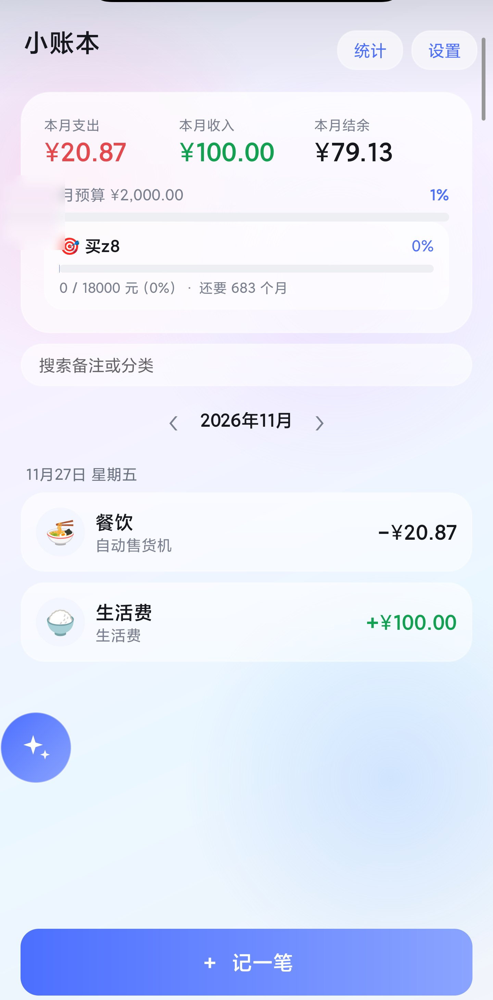
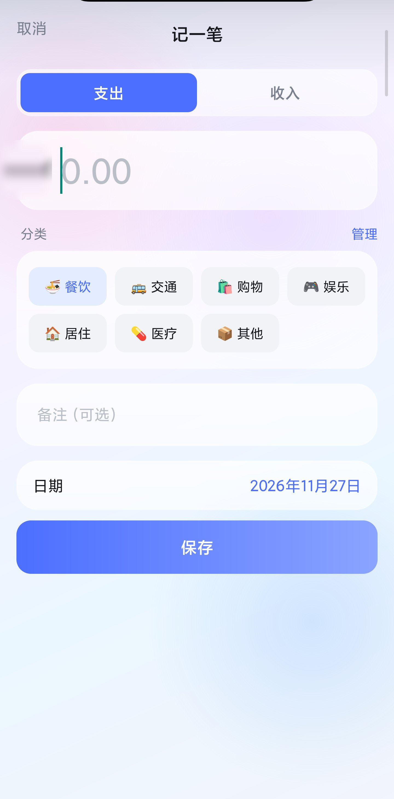
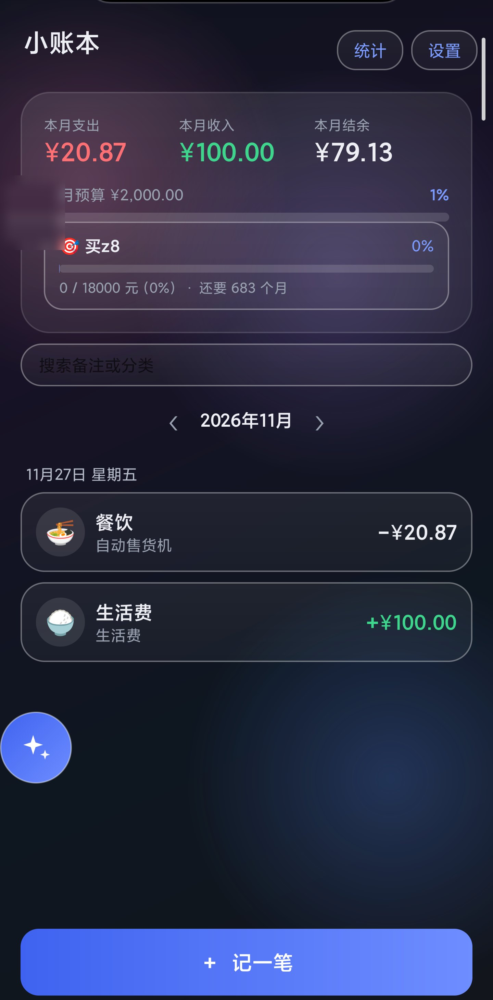
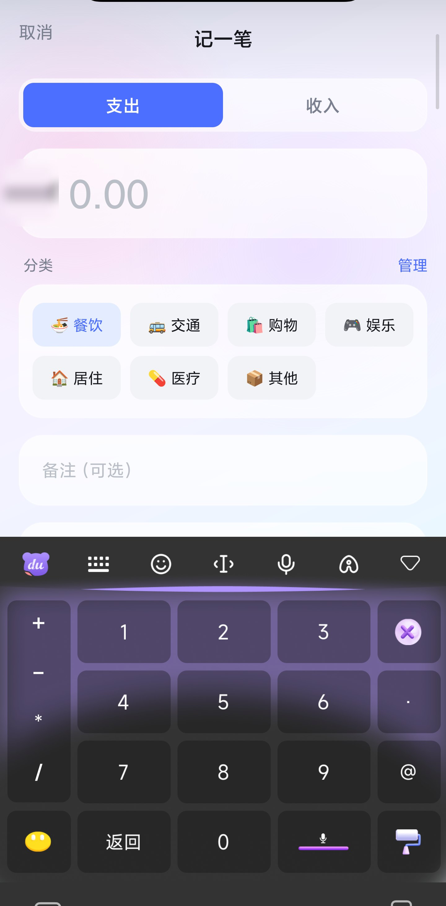
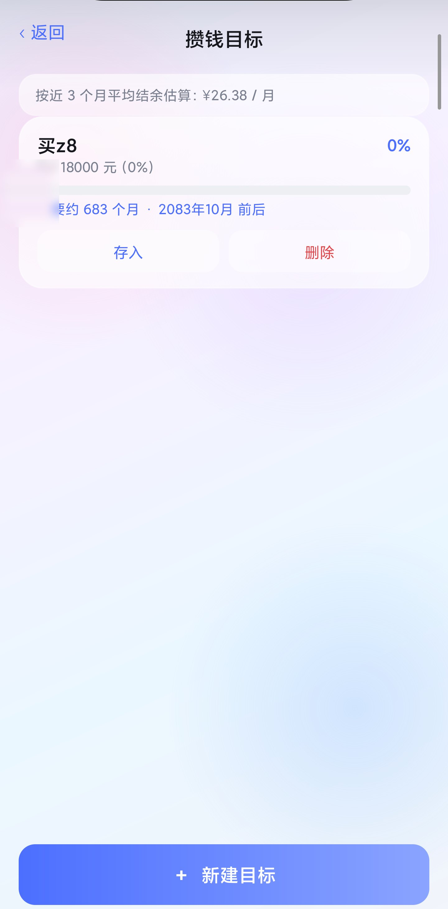
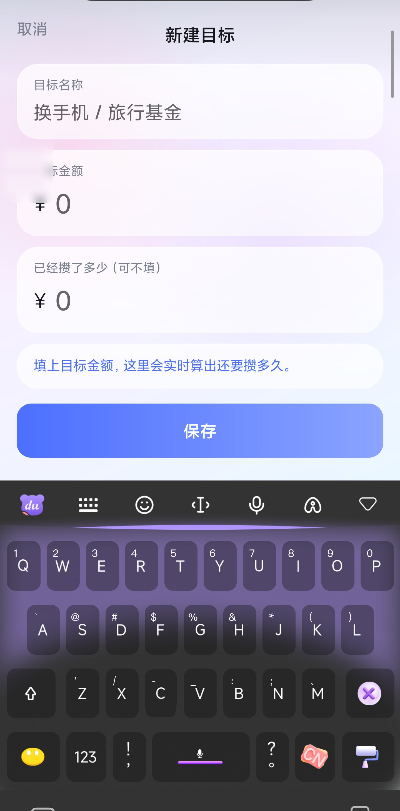
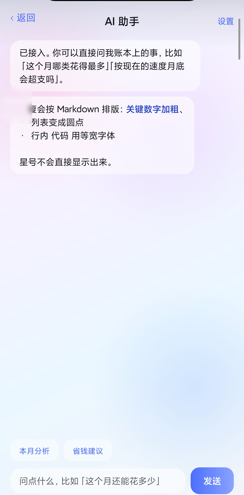
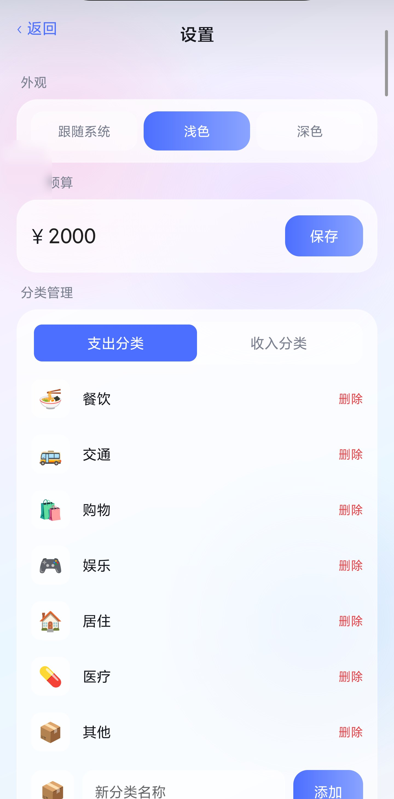

# 小账本

一个 77 KB 的 Android 记账 App。**离线 · 无账号 · 无广告 · 无第三方库**，数据只存在本机 SQLite。

除了记账，还带 AI 助手（自接 API）、攒钱目标、四格式导出、深色主题、桌面小组件和 HyperOS 超级岛。

<p align="center">
  
  
  
</p>

## 下载

- 直接安装：[dist/ledger-2.1.apk](dist/ledger-2.1.apk)（77 KB，arm64/arm32 通吃，纯 Java 无 native 库）
- 系统要求：Android 5.0（API 21）及以上

> 安装包使用作者自签名证书。如果你想自己编译，见下方「构建」。

## 功能

| 模块 | 说明 |
|---|---|
| 记账 | 增删改查、按月切换、按备注/分类搜索、长按删除 |
| 分类 | 内置 7 类支出 + 4 类收入，可增删改、手动指定 emoji 图标、重命名同步历史 |
| 预算 | 设置月额度，主页实时显示已用百分比，超支变红 |
| 统计 | 近 6 个月收支柱状图、分类占比（自绘，无图表库） |
| 攒钱目标 | 目标 + 已攒 + 存入取出，按近 3 个月平均结余自动推算达成时间 |
| 导出 | CSV / Excel(.xlsx) / Word(.docx) / PDF，可选本月或全部 |
| AI 助手 | 自填 OpenAI 兼容接口、一键拉取模型列表、思考强度四档、Markdown 渲染 |
| 外观 | 浅色 / 深色 / 跟随系统，全站统一（含对话框与系统栏） |
| 超级岛 | 自动识别厂商，按 `miui.focus.param` / `oplus.focus.param` / `vivo.focus.param` 注入实时活动 |
| 小组件 | 1×1（今日支出）与 4×2（本月 + 预算 + 今日）自适应 |

## 截图

| | |
|---|---|
|  |  |
|  |  |
|  |  |

## 技术特点

**没有第三方依赖。** 没有 AndroidX、没有 OkHttp、没有图表库、没有 Markdown 库。下面这些全部手写：

- Markdown 渲染（粗体、列表、行内代码、围栏代码块 → `SpannableStringBuilder`）
- XLSX / DOCX 生成（最小可用 OOXML，`java.util.zip` + 手写 XML）
- PDF 导出（系统 `PdfDocument` 绘制表格，自动分页）
- 柱状图与进度条（`Canvas` 自绘）
- 主题系统（颜色全部提成运行时变量，切换后重建页面）

**不用 Gradle。** 构建链是一条 shell：

```
javac → d8 → aapt2 compile/link → zip(classes.dex) → zipalign → apksigner
```

## 构建

需要 `javac`(8+)、Android build-tools（`d8`、`aapt2`、`zipalign`、`apksigner`）、以及某个平台的 `android.jar`。

```sh
# 按你自己的路径改 build.sh 顶部这两个变量
#   AJ=/path/to/android.jar
#   BT=/path/to/build-tools
sh build.sh          # 只构建
sh build.sh --install # 构建并 adb 安装
```

首次构建前先生成签名：

```sh
keytool -genkeypair -keystore keys.jks -storepass <pass> -keypass <pass> \
        -alias ledger -keyalg RSA -keysize 2048 -validity 10000 -dname "CN=Ledger"
```

## 目录结构

```
src/com/dsh/ledger/
  MainActivity.java      主页：汇总、预算、目标、搜索、列表
  AddActivity.java       记一笔 / 编辑
  StatsActivity.java     统计与图表
  GoalActivity.java      攒钱目标列表
  GoalEditActivity.java  新建目标 / 存入
  ChatActivity.java      AI 对话
  SettingsActivity.java  设置
  Db.java                SQLite（v5）
  Export.java            CSV / XLSX / DOCX / PDF
  FocusNotify.java       超级岛 / 实时活动
  LedgerWidget.java      桌面小组件
  Device.java            厂商与系统识别
  Ui.java                主题、颜色、Drawable、IME 处理
  Dialogs.java           圆角对话框
  Md.java                Markdown → Spannable
  AiClient.java          OpenAI 兼容 API 客户端
res/                     图标、布局、样式
```

## 已知限制

- **超级岛**：参数已被系统识别为焦点通知（`focusType=PARAMS`），但缺少 `PROMOTED_ONGOING` 标志位（Android 14 起隐藏 API 受限，反射与逐位爆破均未成功），显示优先级低于系统级应用。OPPO / vivo 的参数格式按公开资料推测，未在真机验证。
- **导出**：XLSX / DOCX 是最小可用 OOXML（纯文本表格），不含样式、图表、合并单元格。
- **AI**：一次性返回，无流式输出；对话历史不跨会话保存。

## 隐私

- 唯一联网行为：AI 对话时把账本摘要发给你**自己配置**的 API 端点；超级岛与通知不联网。
- 不收集任何设备信息，不集成任何统计 SDK。
- 权限只有 `INTERNET` 与 `POST_NOTIFICATIONS`（以及 Android 9 及以下的存储写权限，用于导出）。

## License

[MIT](LICENSE)
